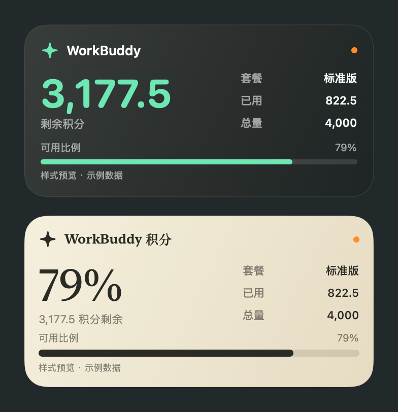

# WorkBuddy Credit Widget

A native macOS menu bar app and WidgetKit desktop widget for viewing your Tencent WorkBuddy credits. Includes dark and paper styles in small and medium sizes. The app UI is currently Chinese.

**Unofficial community project, not affiliated with or endorsed by Tencent.** Website endpoints may change without notice. WorkBuddy is owned by its respective rights holder.



## Install

Requires macOS 14+ on Apple silicon or Intel. Download the universal ZIP from [Releases](https://github.com/sanliqingfeng3378-star/workbuddy-credit-widget/releases), extract it and move **WorkBuddy Credits.app** to Applications. This beta is ad-hoc signed and **not Apple notarized**; macOS may block it. Follow the system's Privacy & Security prompts only after verifying the source, or build from source. Do not disable system protections.

Open the app, select “打开官网登录” to log in through the official website, then “立即刷新” to refresh. Add “WorkBuddy 积分” from the macOS desktop widget gallery. Keep the menu bar app running; closing its main window is fine.

The host queries about every five minutes while running. Widget refreshes are scheduled by macOS and may be delayed. Used/total credits are the website's current resource totals, not daily or monthly spending. Credits are not currency.

## Privacy and limitations

Login uses an independent local WebKit session. The app does not read the installed WorkBuddy client's credentials or send passwords/cookies/tokens to the widget. There is no developer-operated server or telemetry. A loopback-only server on `127.0.0.1:38348` shares credit snapshots; other local processes can read them. Cached snapshots may remain visible while offline.

Personal accounts have been tested locally; enterprise parsing is covered by synthetic tests only. Both CPU architectures are included in universal builds, but this does not guarantee runtime validation on every supported OS/device. Do not run multiple copies simultaneously. Users of the early local 1.0.x prototype may need to log in and re-add widgets because the public bundle identifier changed.

## Build

Requires macOS, Apple Command Line Tools or Xcode, a macOS 14+ SDK, and Python 3. No third-party runtime dependencies.

```sh
bash scripts/test.sh
bash scripts/build.sh
bash scripts/package.sh
```

The app is written to `build/universal/WorkBuddy Credits.app`; ZIP and SHA-256 files go to `dist/`. Pass `arm64` or `x86_64` to both build and package scripts for a single architecture. `WORKBUDDY_WIDGET_SDK` overrides the SDK path; `WORKBUDDY_SIGN_IDENTITY` overrides ad-hoc signing (notarization is a separate step).

MIT license; see [LICENSE](../LICENSE). Never include real account data, cookies or login QR codes in issues or screenshots. See the [Chinese README](../README.md) for more details.
